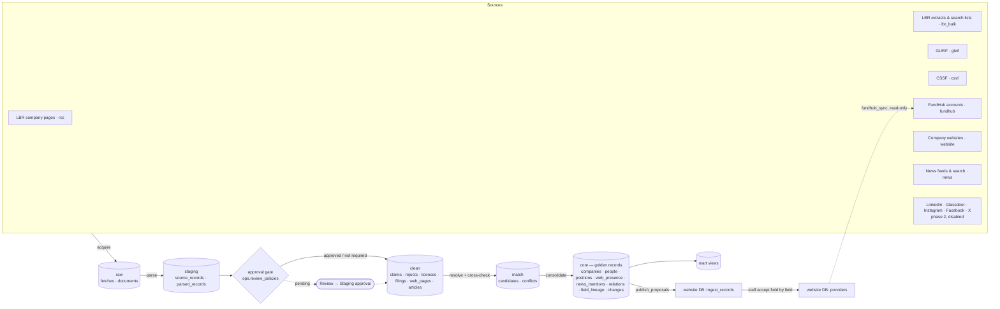

# Company Intelligence pipeline

FundHub's goal is the most complete database of Luxembourg companies. LBR gives the master list, and every other source enriches it and cross-checks it. This page describes how data flows, which tables hold it, and where a person decides.

The live version of this diagram, with row counts, is at **Admin → Company intelligence → Pipeline** (`/admin/engine`).

## Dataflow



The `ops` schema spans every layer. It holds the source registry, attribute precedence, review policies, runs, census, quality checks, LBR capture tooling and news feeds.

## Layers

| Layer (Postgres schema) | What happens | Tables | Code |
|---|---|---|---|
| **raw** | Every acquired content version is stored once and never updated. Its bytes go to object storage, addressed by SHA-256. Unchanged content is not stored again. | `fetches`, `documents` | `pipeline/ingest.ts` |
| **staging** | One row per id at a source. Every parsed version is kept in the source's own vocabulary. An unchanged version stops here, detected by hash. | `source_records`, `parsed_records` | `pipeline/ingest.ts`, `sources/*/parse.ts` |
| **approval gate** | Optional human check. The source's review policy decides whether a version flows on or waits for a person. | `ops.review_policies`, `parsed_records.review_status` | `pipeline/gate.ts` |
| **clean** | Validates and normalizes values (detail below). Facts become claims with history (SCD-2). Refused values become rejects, never silent drops. | `claims`, `rejects`, `licences`, `filings`, `web_pages`, `articles` | `pipeline/clean.ts` |
| **match** | Links a record to a company (detail below). Doubtful matches become candidates. Disagreements between sources become conflicts. | `candidates`, `conflicts` | `core/resolve.ts`, `pipeline/mentions.ts` |
| **core** | Golden records. Each field comes from the most trusted source that states it, and its lineage records which claim won and how many sources agree. Also holds people, positions, web and social presence, news mentions, relations and the change feed. | `companies`, `company_*`, `people`, `positions`, `web_presence`, `news_mentions`, `review_summaries`, `field_lineage`, `changes`, `row_history` | `packages/engine-db/src/core/entity.ts`, `core/golden.ts` |
| **mart** | Read models for the console and analytics. | views `company_profile`, `company_licences`, `coverage_by_source`, `field_completeness`, `pipeline_counts` | `packages/engine-db/drizzle/0001_pipeline_sql.sql` |
| **publish** | Compares golden records with their FundHub listing and writes proposals into the website's review queue. | website `ingest_records` (source `engine`) | `pipeline/publish.ts` |

**Clean stage** rules:
- names
- RCS numbers and LEIs
- URLs: https, no tracking parameters
- e-mails: generic company inboxes only, never a person's address
- phones in E.164 format
- Luxembourg postcodes as `L-1234`
- ISO dates and country codes

**Match stage** order:
1. RCS number, LEI, CSSF id or FundHub listing
2. a verified website domain
3. name and postcode

All code paths are under `services/engine/src/` unless they start with `packages/`.

## Sources

| Code | System | Kind | Acquisition | Status |
|---|---|---|---|---|
| `rcs` | LBR | register (the master list) | a person browses lbr.lu, and the extension captures the pages | built |
| `lbr_bulk` | LBR | register | official extract files and LBR search lists | built |
| `gleif` | GLEIF | secondary register | API, daily delta | built |
| `cssf` | CSSF | regulator (licences) | API | built |
| `fundhub` | FundHub | self-declared | read-only role on the website DB: listings, approved claims, approved self-edits | built |
| `website` | Company website | web | crawl plus Claude extraction | built |
| `news` | News | news | six Luxembourg RSS feeds, plus a per-company news search for followed companies | built |
| `linkedin`, `glassdoor`, `instagram`, `facebook`, `x` | social, people, reviews | phase 2 | public pages only | registered, disabled |
| `manual` | FundHub staff | staff edits | console | built (always wins) |

The website source is held to strict rules:
- It respects robots.txt.
- A site is **verified** only when its pages state the company's own RCS number. Only a verified site contributes identifiers, so a wrong website can never merge two companies.
- Team members are stored with name, title and page link only.

`rcs` and `lbr_bulk` are both LBR, but they stay separate codes because both key their records on the RCS number.

### Precedence (who wins each golden field)

| Kind of field | Fields | Most trusted first |
|---|---|---|
| Legal facts | name, legal form, status, address, registration date, RCS number | `rcs` → `lbr_bulk` → `cssf` / `gleif` → `fundhub` → `website` |
| Descriptive facts | description, services, headcount, contacts | `fundhub` → `website` → `linkedin` |

- Licences come only from the CSSF.
- `manual` (a staff edit) always wins. Clearing it hands the field back to the sources.
- The full ranking is the `ops.attribute_precedence` table, shown on the Sources page and editable in the Database module.
- After changing precedence, run `reprocess --source <code> --from consolidate`.

### Staging approval policies (defaults, editable on the Sources page)

| Source | Policy |
|---|---|
| `rcs`, `gleif` | held when a legal fact changes or the parser version changed |
| `cssf` | held when name, status or LEI changes, or the parser version changed |
| `lbr_bulk` | held when name or status changes |
| `fundhub` | every record is reviewed |
| `website` | held when the AI confidence is below 80% |
| `news` | articles flow automatically; uncertain company mentions wait in Review → Mentions |
| social and people | every record is reviewed |

Approving a version queues `staging_release`, which runs clean → match → core. "Edit and approve" turns the corrected golden fields into staff claims. Rejected versions stay in staging for audit.

## Where a person decides

Everything a person decides is under **Admin → Company intelligence → Review**:
- **Staging approval**: Approve, Edit & approve, or Reject, one at a time or in bulk. Each item shows a field diff against the last released version and a link to the raw page.
- **Matches**: is this the same company?
- **Conflicts**: the sources disagree; mark it checked or ignore it.
- **Mentions**: is this article about this company?
- **Rejects**: what the clean stage refused.

**Publish review** (`/admin/pipeline`) is the last step: accept field by field what reaches the public profile.

## Jobs

| Group | Jobs |
|---|---|
| registers (`cssf`, `gleif`, `rcs`) | `cssf_census`, `cssf_fetch`, `gleif_sync`, `rcs_*` |
| `web` | `fundhub_sync` (hourly), `website_crawl` (nightly batch of due companies, or one company) |
| `news` | `news_poll` (every 30 minutes), `news_search` (daily batch) |
| `maintenance` | `staging_release`, `quality_run` (daily), `publish_proposals` (daily 07:00), `reprocess`, `retention_purge`, `reclassify`, `census_snapshot` |

Run any job by hand with `npm run engine -- run <job> [--flag value]`. On the VM, `fundhub-engine-worker` serves the `cssf,gleif,web,news,maintenance` groups and `fundhub-engine-scheduler` keeps the cron schedules.

## Data quality

`quality_run` measures the checks in `ops.quality_checks` and writes the results to `ops.quality_results`, shown on the Data quality page:
- LBR coverage
- cross-checked share (companies stated by 2 or more sources)
- match rate
- open conflicts
- approval backlog
- reject rate
- freshness
- websites known
- websites verified

## Personal data

People are stored with name, title, role, source page and public profile URL only, never photos or private contacts.

Each source can set `retention_days`. `retention_purge` deletes positions older than that limit, and people left without a position. A GDPR erasure deletes the person row, and their positions cascade.

The terms of LinkedIn, Glassdoor and Meta forbid scraping. Before enabling those sources, decide on the method (public pages at human pace, an official API, or a licensed data vendor) and record the GDPR legitimate-interest assessment.

## Setup

```
npm run engine:db:setup                       # migrations (layered baseline) + seed (sources, precedence, policies, feeds, checks)
cp services/engine/.env.example services/engine/.env
#   ENGINE_DATABASE_URL, ANTHROPIC_API_KEY (website source),
#   WEBSITE_DATABASE_URL_RO (fundhub source), WEBSITE_DATABASE_URL_PUBLISH (publish)
ENGINE_RO_DB_PASSWORD=… npm run db:roles      # website DB: creates the read-only fundhub_engine_ro role
npm test -w @fundhub/engine
```
